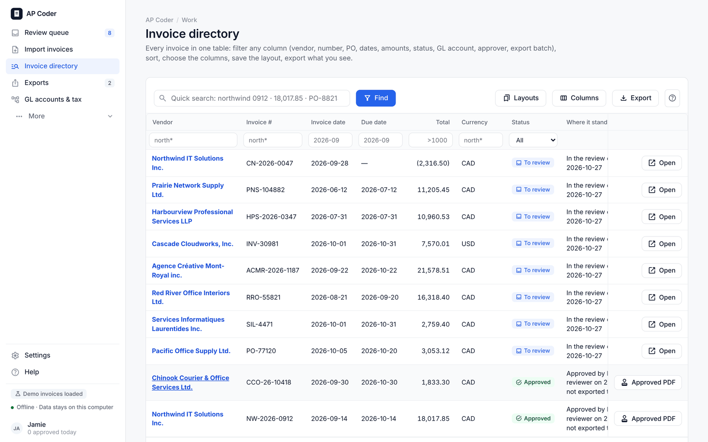
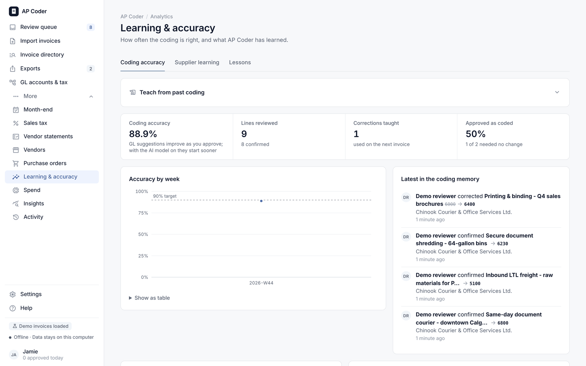

# AP Coder

**An offline AI assistant for Accounts Payable.** It reads Canadian supplier invoices, codes them to your GL
accounts and cost centers, checks GST/HST/PST/QST and the math, learns from every approval, and exports approved
invoices to JD Edwards E1 or Excel.

[](https://github.com/MNabikhel/AP_Processer/actions/workflows/ci.yml)

It runs on one laptop, or on one company server for the whole AP team. Every invoice is read on that machine, by
OCR and by small models in [LM Studio](https://lmstudio.ai/), and nothing leaves it unless an Admin switches on one
of the [exceptions](#what-leaves-the-laptop).


## Where it stands

| | |
|---|---|
| **Laptop pilot** | Ready: checked end to end, the way a pilot tester uses it. Next: a 4-week shadow pilot with AP. |
| **Company server** | Built and security-reviewed (HTTPS, logins, four roles), sized for about 500 users. Not installed yet: [docs/SERVER.md](docs/SERVER.md). |
| **JD Edwards E1** | Approved invoices go out as JDE's standard batch files (F0411Z1/F0911Z1). The direct API connection is built and waits for the JDE team: [docs/JDE_E1.md](docs/JDE_E1.md). |
| **Finance AI Hub** | AP Coder's feed to Microsoft Fabric is built (off until an Admin turns it on): [docs/FINANCE_HUB.md](docs/FINANCE_HUB.md). |
| **Quality** | About 4,500 automated tests run on every change, on Windows and Linux; the install and the update are checked on clean Windows and Mac machines. Every bug fixed gets its own test ([docs/BUGS.md](docs/BUGS.md)). |

## What it does

1. **Reads every invoice on the machine:** PDFs, scans, phone photos and emails (`.eml`, `.msg`). Each value gets a
   confidence (*verified*, *likely*, *check*, *missing*) and is boxed on the page.
2. **Codes each line** to your GL accounts and cost centers: from what AP approved before, then fixed rules, then a
   local model for what is left. It can only pick codes from your chart.
3. **Checks everything in code, not by AI:** totals, the tax rate for the province and date, registration numbers,
   duplicates (under another vendor name too, or already in the ERP), vendor fraud signals, the PO match and
   payment terms.
4. **A person reviews and approves.** Every correction is remembered for that vendor's next invoice. A vendor whose
   record proves it can go touchless, once an AP lead switches that on (off by default).
5. **Exports** approved invoices to JD Edwards or Excel/CSV, and covers the rest of the AP cycle: month-end
   accruals, the sales-tax claim, vendor statements, a duplicate payment audit and the audit trail.

```
invoice (PDF, scan, photo, email) ─► read on the machine: text layer or OCR, and OvisOCR2 ─► fields, boxed on the page
                                                                     │
   what AP approved before · fixed rules · the vendor list ──────────┤  local model, only for lines still uncoded
                                                                     ▼
            checks: totals · tax rates · QST base · duplicates · fraud signals · PO match
                                                                     │
                                                                     ▼
            review ─► approve ─► learning memory ─► JD Edwards E1 / Excel export
```

## Screens

| | |
|---|---|
|  |  |
|  |  |

**Want to look around?** Start AP Coder and click **Load demo invoices**: ten sample invoices from across Canada,
with sample purchase orders and a vendor list. (The screenshots are of these samples.)

## Get started on a laptop

1. **Start LM Studio's server** with OvisOCR2 downloaded and a chat model loaded (Gemma 4 12B, or Qwen 3.5 9B):
   [docs/LM_STUDIO.md](docs/LM_STUDIO.md).
2. **Unzip AP Coder** to a folder OneDrive does not sync (for example `C:\APCoder\app`): GitHub's ZIP (**Code →
   Download ZIP**), or the offline bundle IT gives you.
3. **Double-click `APProcessor.bat`** (Mac: `APProcessor.command`).

The first time, it sets up its own Python environment, the packages and the OCR models, and makes a desktop
shortcut. Each start then checks the setup and opens the dashboard in your browser, at `http://127.0.0.1:8501`:

```
AP Coder readiness:
  ✓ Python 3.12.10
  ✓ Packages: all 15 in place
  ✓ OCR for scanned invoices
  ✓ Chat model: lmstudio-community/gemma-4-12B-it-QAT-GGUF loaded in LM Studio (can see pages)
  ✓ Page reader: ath-maas_ovisocr2 found, self-test passed (reads every page of every invoice)
  ✓ Setup checks: all 9 passed (GL accounts, tax mapping, coding rules, settings)
  ✓ Self-check OK: 10 of 10 sample invoices read right, and a scan with local OCR (9 s)
```

A problem is one plain line in that list, and AP Coder still starts. Keep the window open while you work; close it
to stop AP Coder. Your data lives outside the code (`~/APCoder`), so an update never touches it.

Next: real data step by step in [docs/GETTING_STARTED.md](docs/GETTING_STARTED.md), or the one printable page in
[docs/QUICK_START.md](docs/QUICK_START.md) (also under Help → Quick start).

## What leaves the laptop

Nothing, by default. The data stays in a local folder outside the code, the dashboard listens only on `127.0.0.1`,
and a test fails if any page tries to reach the internet. Only redacted reports (`doctor`, `share-report`) are
meant to be sent to anyone.

Each exception is off until someone switches it on, on purpose:

- **The Azure check** (*Settings → Reading*): a second opinion from your organisation's Azure resource on the
  invoices AP Coder isn't sure of.
- **The finance hub feed** (*Settings → Finance hub*): tables written to a shared folder Microsoft Fabric reads.
- **The JD Edwards API** (*Settings → JD Edwards E1*): your company's own JD Edwards server, on the internal network.
- **Server mode**: the dashboard on the office network, over HTTPS, with logins.

Every place the network could be touched: [docs/HOW_IT_RUNS.md](docs/HOW_IT_RUNS.md).

## Guides

| For | Read |
|---|---|
| The pilot tester | [QUICK_START.md](docs/QUICK_START.md) (one page), [GETTING_STARTED.md](docs/GETTING_STARTED.md) (step by step), [PILOT_PLAN.md](docs/PILOT_PLAN.md) (the 4-week pilot) |
| IT, a laptop | [PILOT.md](docs/PILOT.md) (install, the offline bundle), [LM_STUDIO.md](docs/LM_STUDIO.md), [UPGRADING.md](docs/UPGRADING.md), [MAILBOX_SETUP.md](docs/MAILBOX_SETUP.md) |
| IT, the company server | [SERVER.md](docs/SERVER.md) |
| The JD Edwards team | [JDE_E1.md](docs/JDE_E1.md), [JDE_ORCHESTRATIONS.md](docs/JDE_ORCHESTRATIONS.md) |
| The data team | [FINANCE_HUB.md](docs/FINANCE_HUB.md) |
| Finance and tax | [SALES_TAX.md](docs/SALES_TAX.md), [CODING.md](docs/CODING.md) |
| How it all works | [REFERENCE.md](docs/REFERENCE.md) (every feature, page and command), [HOW_IT_RUNS.md](docs/HOW_IT_RUNS.md), [CAPTURE_DESIGN.md](docs/CAPTURE_DESIGN.md), [WHATS_NEW.md](docs/WHATS_NEW.md) |

## For developers

```bash
python -m venv .venv && source .venv/bin/activate     # Windows: .venv\Scripts\activate
pip install -e ".[ocr,dev]"
python -m ap_coder serve                              # the dashboard: http://127.0.0.1:8501
python -m ap_coder doctor --online                    # the setup check, as a report
python scripts/check.py                               # lint and the tests of what you changed
python -m pytest -q                                   # the default tests (the whole suite: -m "", as CI runs it)
```

The code is in `ap_coder/`: `core` (the database and settings), `capture` (reading a document), `ai` (the pipeline
and the models), `coding` (tax and checks), `erp` (exports and reports), `intake` (pictures and emails), `ops`
(the command line and the doctor), `web` (the dashboard), `bench` (the accuracy benchmark). Coding agents start
from [CLAUDE.md](CLAUDE.md). Choices made along the way: [docs/decisions.md](docs/decisions.md); every bug fixed:
[docs/BUGS.md](docs/BUGS.md).
