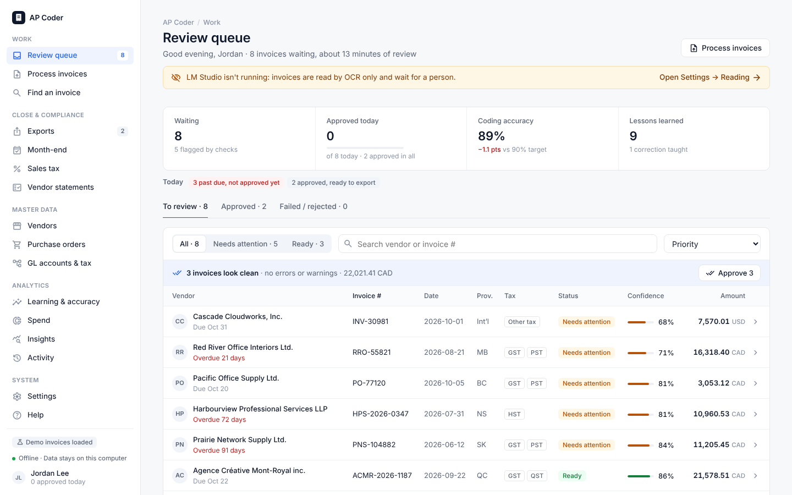
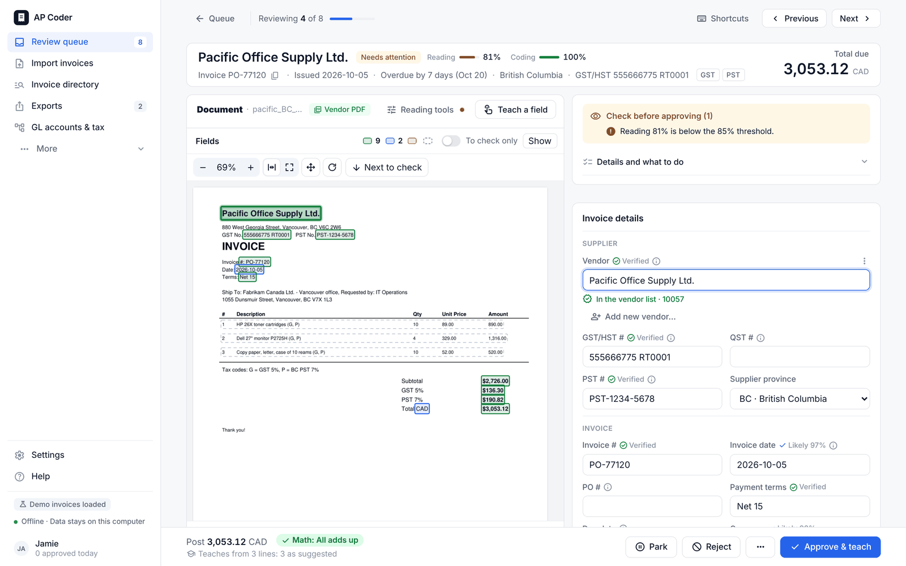
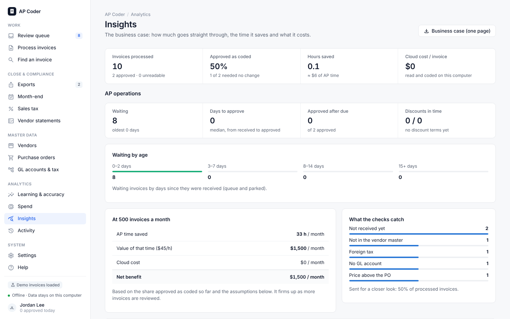
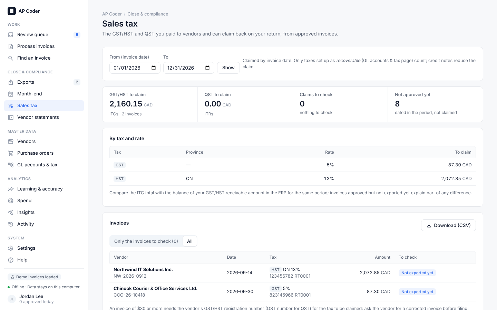
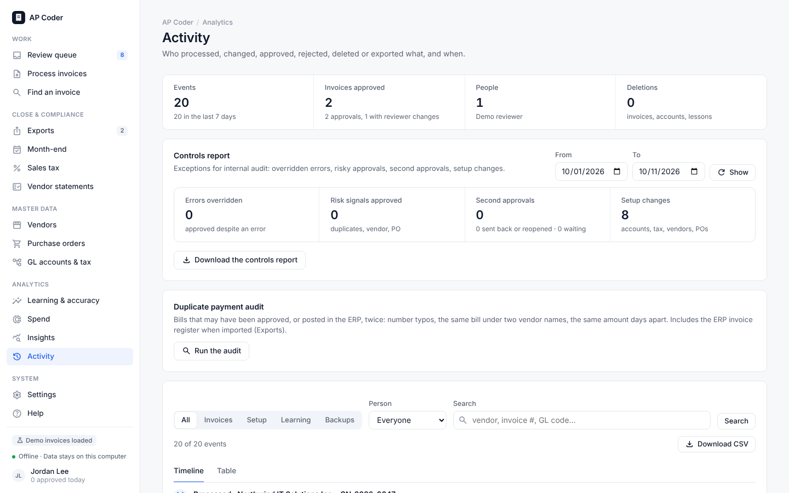
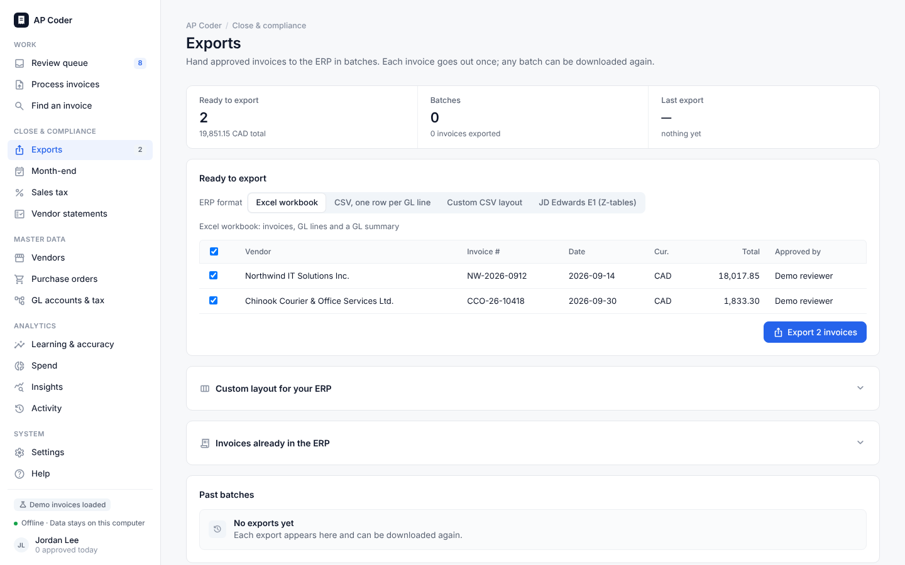
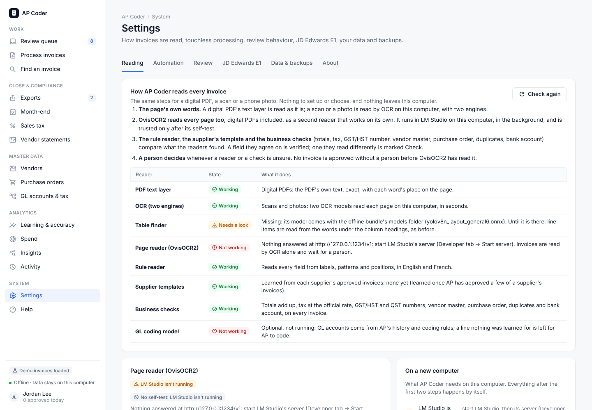

# AP Coder

**Invoice capture, GL coding and Canadian sales-tax checks for Accounts Payable, on one laptop.**
AP Coder reads each invoice, checks every number, proposes the GL split and learns from what AP approves.
It then exports approved invoices to JD Edwards E1. It runs fully offline: every invoice is read on the
laptop by OCR and by OvisOCR2, a small page-reading model in [LM Studio](https://lmstudio.ai/). A chat model
(Gemma 4 12B or Qwen 3.5 9B) is optional, and no data leaves the laptop.



## Set up: start LM Studio, double-click

1. **Start LM Studio's server** (*Developer → Start server*) with the chat model loaded (**Gemma 4 12B**, or Qwen
   3.5 9B) and OvisOCR2 downloaded. Both are optional, and AP Coder reads invoices without them. Links and settings:
   [docs/LM_STUDIO.md](docs/LM_STUDIO.md).
2. **Unzip AP Coder** to a folder that OneDrive does not sync (e.g. `C:\APCoder\app`): GitHub's ZIP (**Code →
   Download ZIP**), or the offline bundle IT gives you for a laptop with no internet.
3. **Double-click `APProcessor.bat`** (Mac: `APProcessor.command`; the first time, right-click → *Open*; see
   [PILOT.md](docs/PILOT.md#install-one-button) for macOS 15's *Open Anyway*).

That's it, the first time and every day after. The first time it sets up what is missing, once: its own Python
environment (`.venv`, from the Python already installed: 3.11 or newer), the packages (from the offline bundle,
or downloaded once from GitHub's ZIP, as CloseDesk does), the OCR models, the data folder (`~/APCoder`, outside
the code, so updates never touch it) and one desktop shortcut. Every start then checks everything that
`python -m ap_coder doctor --online` checks, prints it, and opens the dashboard:

```
AP Coder readiness:
  [OK] Python 3.12.10
  [OK] Packages: all 15 in place
  [OK] OCR for scanned invoices
  [OK] Data folder: C:\Users\you\APCoder
  [OK] Chat model: lmstudio-community/gemma-4-12B-it-QAT-GGUF loaded in LM Studio (can see pages)
  [OK] Chat model test passed: accounts from the chart in 4s: line 1 -> 6100, line 2 -> 6400
  [OK] Page reader: ath-maas_ovisocr2 found, self-test passed (reads every page of every invoice)
  [OK] Setup checks: all 9 passed (GL accounts, tax mapping, coding rules, settings)
  [OK] Desktop shortcut 'AP Coder' made
  [OK] Self-check OK: 10 of 10 sample invoices read right, and a scan with local OCR (9 s)
```

The first time takes a few minutes; later starts take seconds and install nothing. A problem is one plain line in
the summary, and AP Coder still starts. Double-clicking while it runs opens the running copy. Keep the window open
while you work; close it to stop AP Coder.

- **OvisOCR2** (about 1 GB) reads every page of every invoice as a second reader. AP Coder finds it in LM Studio
  and tests it by itself (10 to 20 minutes the first time; *Settings → Reading* shows how it is doing). You can use
  AP Coder meanwhile: invoices are read by OCR and wait for a person until it passes.
- **The chat model** suggests GL accounts for lines nothing was learned for, and, as it can see pages, reads each
  invoice's header from the page images as one more reader. Without it, lines are coded from what AP approved
  before and from fixed rules ([docs/CODING.md](docs/CODING.md)).

This is an offline enterprise build: AP Coder itself never connects to the internet; only the setup from GitHub's
ZIP downloads its packages and models, once. For IT (the offline bundle, `--installer`, what CI checks on clean
Windows and Mac machines): [docs/PILOT.md](docs/PILOT.md). Real data, step by step:
[docs/GETTING_STARTED.md](docs/GETTING_STARTED.md); its one-page summary for the pilot tester, to print:
[docs/QUICK_START.md](docs/QUICK_START.md) (also under Help → Quick start). Updating from an older version:
[docs/UPGRADING.md](docs/UPGRADING.md).

## Screens

| | |
|---|---|
|  |  |
|  |  |
|  |  |

**Just want to look around?** Start the dashboard and click *Load demo invoices*. You get ten sample
invoices from across Canada, with sample POs and a vendor list.

## What it does

1. **Reads the invoice on the laptop.** AP Coder uses the PDF's text layer, or local OCR (RapidOCR
   PP-OCRv4, with a PP-OCRv5 second read) for scans and photos. It reads the header, every line, and every
   GST, HST, PST and QST line. Each field gets a measured confidence (*verified*, *likely*, *check* or
   *missing*) and is boxed on the page. The **page reader** (OvisOCR2, a small page-reading model in LM
   Studio) reads every page of every invoice again on its own, in the background, as an independent second
   reader.
2. **Codes each line** to your GL accounts and cost centers. It tries, in order:
   - what AP approved before for that vendor (shortened words, plurals, French or English allowed for);
   - what AP approved for the same item from other vendors, when they agree;
   - the vendor's usual account, once all of its lines went to one account;
   - the local model, only for what is left;
   - then the fixed rules set by AP, applied last, so they always win.

   It can only pick codes from your chart, never invent one. A weak match (the vendor master's default account,
   an account's name) is offered on the review screen, not used on its own. Measured without any AI model in
   [docs/CODING.md](docs/CODING.md): 99.5% of the accounts it fills in are right.
3. **Checks everything in code, not by AI:**
   - totals reconcile;
   - tax = taxable amount × the official rate for the province and date, the right regime, and the QST base;
   - registration numbers;
   - duplicates (also under another vendor name, or already in the ERP), and vendor fraud signals
     (unknown or held vendor, changed GST number or bank account);
   - credit notes, the PO match (price, quantity ordered and received), payment terms and discounts;
   - agreement with past decisions.
4. **Builds the GL distribution.** The posting lines add up to the amount payable to the cent. Recoverable
   GST/HST and QST go to their own accounts; non-recoverable PST is spread over the expense lines.
5. **Review and learning.** AP reviews, corrects and approves. Every approval is remembered and used for that
   vendor's next invoice and trains that vendor's template. With touchless processing turned on, a vendor
   whose own invoices prove at least 99% accurate is approved without a person (see below).
6. **The rest of the AP cycle:**
   - ERP export batches, including JD Edwards E1 F0411Z1/F0911Z1 Z-files;
   - the *Invoice directory* for vendor calls and lookups (filter any column, sort, export), and vendor emails
     drafted for you;
   - second approval above a limit;
   - vendor statement reconciliation and month-end accruals;
   - the sales-tax claim, spend analysis and a duplicate payment audit;
   - the audit trail with a controls report;
   - the business case, built from the pilot's own numbers.

```
invoice (PDF, scan, photo, .eml/.msg) ─► local reader: text layer or OCR ─► fields + confidence, boxed on the page
        └─► page reader (OvisOCR2, every page, in the background) ─► agrees: verified · differs: check
                                                                     │
   fixed rules · vendor history · vendor master · account names ─────┤  local model (LM Studio),
                                                                     │  only for lines still uncoded
                                                                     ▼
            checks: totals · tax math · province rates · QST base · duplicates · fraud · PO match
                                                                     │
                                                                     ▼
            GL distribution ─► review dashboard ─► approve ─► learning memory ─► ERP / JDE E1 export
```

Everything stays in a local data folder outside the code (default `~/APCoder`). The dashboard listens only
on `127.0.0.1` (unless IT sets `AP_DASHBOARD_ADDRESS`), and a test fails if any page tries to connect to the
internet. Only redacted reports (`doctor`, `share-report`) are meant to leave the laptop. How the launcher, the
update and the server work, what is written where, and every place the network could be touched:
[docs/HOW_IT_RUNS.md](docs/HOW_IT_RUNS.md).

## How every invoice is read

One way for every invoice, with nothing to configure. A digital PDF, a scan and a phone photo (iPhone HEIC
too) go through the same steps:

- **Every invoice becomes a PDF.** A photo or scan (JPG, PNG, HEIC, TIFF) is turned into a PDF when it
  arrives; the original is kept next to it, and a photo sent twice is still caught as a duplicate.
- **The page's own words.** A digital PDF's text layer is read as it is; a scan or a photo is read by OCR on
  the laptop, with two engines (tilted scans are straightened first).
- **The table finder** (a small layout model, as in CloseDesk, in the offline bundle) finds the line-item
  table on each page, so line items are read from the table alone.
- **OvisOCR2 reads every page too**, digital PDFs included, as an independent second reader. It runs in LM
  Studio, in the background, and is trusted only after its self-test, which runs on its own.
- **The rule reader, the supplier's template and the business checks** (totals, tax, GST/HST number, vendor
  master, PO, duplicates, bank account) compare what the readers found. A field they agree on is
  *verified*; one they read differently is marked *Check*. Line items must agree between the table reading
  and OvisOCR2 (`LINE_ITEMS_AGREE`), or the invoice goes to a person.
- **Hidden text is checked against the page.** On a digital PDF, the text layer is compared with what
  OvisOCR2 sees printed (`TEXT_LAYER_MATCHES_PAGE`). A PDF whose hidden text gives another total than its
  page shows is flagged.
- **A person decides** whenever a reader or a check is unsure. No invoice is approved without a person
  before OvisOCR2 has read it.

*Settings → Reading* shows each reader's state, OvisOCR2's self-test (*Run the self-test again*), its queue,
how often it agrees with the PDF's own figures, and the models in LM Studio.

## Touchless processing

Touchless processing is **off** until an AP lead turns it on (*Settings → Automation*, with a confirmation,
recorded in the Activity log). Until then every invoice is approved by a person, and each approval keeps
training its vendor.

- **One switch, one bar.** With the switch on, a vendor goes touchless by itself once it meets the same
  fixed bar as every other vendor: at least 20 reviewed invoices, header fields read right at least 99% of
  the time with 95% confidence over its last 200 invoices, and the last 10 without a correction. With
  about 13 header fields an invoice, that usually takes about 30 clean invoices.
- **Checked as it goes.** 5% of touchless invoices still go to a person. One correction, or a touchless
  invoice reopened, suspends the vendor until it has a fresh clean streak. An AP lead can *Keep supervised*
  any vendor (*Learning & accuracy → Supplier learning*).
- **Always a person**, whatever the vendor's record: a changed bank account or GST/HST number, any sign of
  a duplicate, an unusual amount, a vendor not in the vendor master or on hold, a credit note, a total
  above the *Largest invoice approved without a person* (5,000.00 CAD by default) or above the
  second-approval limit, an invoice OvisOCR2 has not read yet, and any failed check.
- **Clerks train it.** *Approve & teach* records each corrected field for that vendor and updates its
  template; the confirmation says what was learned and how far the vendor is from touchless. Bulk
  approvals nobody opened don't count toward the bar.

This follows how the AP automation industry does it: one pipeline that uses the text layer when there is
one and OCR otherwise (ABBYY, Google Document AI); agreement between independent readers as the strongest
confidence signal; calibrated confidence per field, with a document touchless only when every field passes
(Rossum); business rules that can block (Rossum, Stampli) and invoices that always need a person
(Stampli); learning per vendor from corrections (ABBYY, Vic.ai); and a random audit sample (AWS Augmented
AI). The numbers to watch are the touchless rate and the error rate of touchless invoices (*Settings →
Automation*): Ardent Partners puts the average touchless rate at 32.6%, and best in class at about 49%.

## Run it by hand (developers)

In an offline bundle, the launcher, the installer and `scripts/fetch_models.py` never go online: packages only
from the bundle's `wheelhouse/` (`pip --no-index`), OCR models only from its `models/`, no `git` update, no
`winget` Python. From the code alone (GitHub's ZIP or a git checkout: no `bundle_manifest.json`, `wheelhouse/`
or `models/`) the launcher's setup downloads what is missing, once, like CloseDesk: packages from PyPI, the
PP-OCRv5 models from www.modelscope.cn, and APProcessor.bat offers Python 3.12 with `winget`; the dashboard it
starts stays offline. `AP_ALLOW_INTERNET=0` forbids those downloads. **`AP_ALLOW_INTERNET=1`**
(`set AP_ALLOW_INTERNET=1` in cmd, `export AP_ALLOW_INTERNET=1` in bash) also lets `APProcessor.bat
--installer` update a git checkout and the app use a server or Azure on the internet. `scripts/build_offline_bundle.py` sets it for itself (building the
bundle is the one step that downloads). CI's online jobs set it; its offline-bundle job runs without it.

```bash
python -m venv .venv && source .venv/bin/activate
pip install -e ".[ocr,dev]"
python -m ap_coder doctor --online   # the same checks as a start, as a report to paste (troubleshooting)
python -m ap_coder serve             # the dashboard: http://127.0.0.1:8501 (or the next free port)
python scripts/pilot_check.py        # reads the ten samples offline and compares them with their answers
```

### LM Studio settings

Every invoice is coded the same way, with nothing to choose: the header, lines and taxes come from the local
readers, each line's GL account from what AP approved before and the coding rules, and the chat model in LM
Studio (found on its own: the chat model loaded, by AP Coder or CloseDesk, else Qwen 3.5 9B when it is
downloaded, never just the first model on LM Studio's list; never OvisOCR2 or an embedding model) suggests an account for a
line nothing was learned for. When LM Studio isn't running, that line is left for AP; nothing else changes.

**Settings → Reading** shows what was found: each reader's state (the GL coding model among them, e.g.
*qwen3.5-9b in LM Studio*), with a **Check again** button, and *Models in LM Studio* with **Load**.

Qwen 3.5 is asked not to think (`reasoning_effort: "none"`, which LM Studio honours from 0.4.8 on). Replies
are still read when they come wrapped in `<think>` blocks or code fences, or when the answer is left in the
model's reasoning. If the model spends its whole budget thinking, AP Coder reports a plain error instead of
coding nothing silently. Speed and model advice are in [docs/PILOT.md](docs/PILOT.md).

| Setting | Default | |
| --- | --- | --- |
| `AP_LLM_BASE_URL` | `http://127.0.0.1:1234/v1` | any address LM Studio shows; Ollama: `http://127.0.0.1:11434/v1`. On this computer or the office network only: a server on the internet is never asked (developers: `AP_ALLOW_INTERNET=1`) |
| `AP_LLM_MODEL` | empty | empty = the chat model LM Studio has (never an embedding model or OvisOCR2) |
| `AP_LLM_MAX_PROMPT_CHARS` | `24000` | invoice text sent; a longer one keeps its start and end |
| `AP_LLM_TIMEOUT_SECONDS`, `AP_LLM_MAX_TOKENS` | `600`, `4096` | a laptop without a graphics card is slow |

**Azure is for developers only.** This build never connects to the internet: Azure Document Intelligence and
Azure OpenAI are used only when the internet is allowed (`AP_ALLOW_INTERNET=1`) and they are set in
*Settings → Reading → Developer: cloud services* (shown only then); those services then do the reading and
coding instead. The offline installer asks no cloud questions. There is nothing else to choose: the older
settings `AP_PAGE_READER`, `AP_PAGE_READER_SCOPE`, `AP_LLM_PROVIDER`, `AP_VISION` and `AP_LLM_VISION` are
no longer needed. They use strict Structured Outputs, and every check after
coding is the same.

### Page reader: OvisOCR2 reads every invoice as a second reader

OCR misreads digits on phone photos and poor scans. The page reader, OvisOCR2, is a small vision model that
reads the page image on its own and writes out its text and tables, on every page of every invoice: digital
PDFs, scans and photos (iPhone HEIC photos too). AP Coder reads that with the same rule reader and compares it
with the PDF's text or OCR, field by field:

- both read the same value: the field can be *verified* (two independent readers agree, and the checks pass);
- they read different values: the field is marked *check* for AP;
- only the page reader found it: *likely* at best;
- on a digital PDF, the page as printed is checked against the text hidden in the PDF
  (`TEXT_LAYER_MATCHES_PAGE`): an edited PDF whose text says another total than its page shows is flagged.

**Nothing to set up.** OvisOCR2 is in LM Studio already (installed by IT with the chat model: the *bartowski*
build at **Q8_0**, about 1 GB) and AP Coder finds it on its own, on the same LM Studio as the chat model, and
has LM Studio load it when there is a page to read. Nothing is downloaded: AP Coder never connects to the
internet. Before it reads any invoice it tests itself on a scan of a sample invoice whose answers are known
(10 to 20 minutes on a laptop, once per model), on its own, with no button to press; a failed test is tried
again a day later, or with *Run the self-test again* in *Settings → Reading*. No other model reads pages instead: without OvisOCR2 the invoices are read by the PDF's text and
OCR alone, they wait for a person, and a banner on the Process and Review pages says so.

It reads in the background while the dashboard is open (or overnight: `python -m ap_coder read-pages
--minutes 240`) and never holds up *Import invoices*. An invoice is in the review queue at once, read by the
PDF's text or OCR; its fields update when the page reader is done, unless AP has started editing it. No invoice
is approved without a person before the page reader has read it.

**Measured** on 9 real scans with known answers ([details](docs/CAPTURE_DESIGN.md#measured-with-ovisocr2)):
OCR alone read 87 of 91 header fields right and verified 41; with the page reader, 91 of 91 right and 81
verified, line items 56 of 56 (31 with OCR alone), and no wrong value verified. A page takes minutes on a laptop
CPU, so it reads in the background.

**Building confidence for touchless processing.** Every approval scores each reader (OCR, the page reader,
the supplier's template, the AI) against what AP approved. *Learning & accuracy → Readers* shows each
reader's record, field by field. The same approvals tune the confidence labels to your own invoices (local
calibration, on top of the benchmark). *Export training data* packs the approved invoices (page images and
the approved fields) to fine-tune a vision model on them later.

## Dashboard

The dashboard is a local web app, hosted the same way as CloseDesk: a small FastAPI server (run by uvicorn) on
this computer, at `http://127.0.0.1:8501`, opened in your usual browser. Nothing is installed in the browser and
nothing is served to the network: it listens on `127.0.0.1` only (set `AP_DASHBOARD_ADDRESS=0.0.0.0` to let
colleagues on the office network open it; each of them gives their name once, on a "Who are you?" page, and their
approvals and changes are recorded in that name and with their computer's address), refuses requests addressed to
any other name, and only its own pages can change anything. The launcher starts it (`python -m ap_coder serve`), opens the browser once it answers, and
on the next double-click finds it through `GET /healthz` and opens it instead of starting a second copy. An update
stops the running one cleanly (`POST /shutdown`, with a token only this computer's data folder holds) before the new
version takes over. Fonts, icons and scripts all come from the app; nothing is loaded from the internet.

The left rail groups the pages; each page has its own address, so a page (or an invoice, `/review/<id>`) can be
bookmarked or opened in a second tab.

| Rail section | Page | What it does |
|---|---|---|
| Work | **Review queue** | Today's work, the queue (filter, search and sort in the address), bulk approval of clean invoices, and the Second approval, Parked, Approved and Failed / rejected tabs. Each invoice opens its **review screen** (`/review/<id>`): the invoice image beside the editable header (incl. PO #, payment terms, due date, bank account to pay into); live **Checks**, each with what to do; the line grid (GL account and cost center dropdowns of your codes); tax lines with a tax-check table; the **PO match**; **GL suggestions** for lines the AI could not code; *Split a line* across GL accounts / cost centers; a GL posting preview; **Ask the vendor** drafts the email for what the invoice is missing (English or French). *Approve & teach*, *Reject*, *Delete*. The queue shows due dates and discount deadlines, can be sorted by due date, and clean invoices can be approved in bulk. A **Second approval** tab holds invoices over the approval limit; *Park* sets aside an invoice waiting for information (**Parked** tab); **Notes** keep the team informed. |
| Work | **Import invoices** | Upload files or saved emails (`.eml`, or `.msg` from classic Outlook), or process new files dropped into the data folder's `invoices/` (or run `watch`). Each email is **sorted** (invoice, credit note, statement, payment reminder, bank-detail change, not for AP): only invoices and credit notes reach the review queue, and *Emails that need a person* lists the rest, bank-detail changes first as possible fraud. Getting the AP mailbox's emails there: [docs/MAILBOX_SETUP.md](docs/MAILBOX_SETUP.md). |
| Work | **Invoice directory** | Every invoice in one table, like JD Edwards' query by example: a filter box over each column (vendor, invoice and PO number, dates, amounts, status, GL account, approver, export batch; `north*`, `>1000`, `2026-07..2026-09`), sort by any heading, 100 a page, the columns chosen and ordered, layouts saved by name (one opens first), and the filtered rows exported to Excel or CSV. Each row says where the invoice is (in review, parked and why, approved by whom, exported in which batch, rejected); the quick search finds a vendor's invoice by number or amount, in the ERP register too. |
| Close & compliance | **Exports** | Approved invoices go to the ERP in batches (Excel, CSV, or a **custom CSV layout** matching your ERP's import); each invoice once; any batch can be downloaded again or undone; **approved PDFs** (stamp and coding page) per batch. Import the ERP's invoice register to catch bills already entered there. |
| Close & compliance | **Month-end** | The accruals schedule: received not invoiced (from POs), invoices not in the ERP yet, expected recurring invoices; by GL; CSV. |
| Close & compliance | **Sales tax** | GST/HST (ITCs) and QST (ITRs) to claim back for a period, by tax and rate, with the claims to check before filing (no valid registration number on the invoice, foreign currency); PST / QST possibly to self-assess; CSV. |
| Close & compliance | **Vendor statements** | Upload a vendor's statement of account: matched, amount differs, not received, not on the statement; the email asking for the missing invoices. |
| Master data | **Vendors** | Import the **vendor master** from the ERP (vendor IDs in exports, unknown vendors flagged, vendor terms, default GL); spend, AI accuracy and controls per vendor (hold, expected GST/HST number, notes); recurring vendors and late invoices. |
| Master data | **Purchase orders** | Import open POs (one row per line, received quantities optional); what has been invoiced against each; close, reopen, delete. |
| Master data | **GL accounts & tax** | Import GL accounts (cost codes) from CSV/Excel by choosing the **code**, **description** and **category** columns; edit, categorise, delete. Optional cost centers. Tax treatments and GLs. Coding policy. **Fixed rules** (vendor and/or words → GL account and cost center), with rules suggested from past coding. |
| Analytics | **Learning & accuracy** | AI accuracy against the 90% target, weekly trend, per-vendor accuracy, most common corrections, and the memory itself (*Forget* a bad lesson). *Teach from past coding* imports last year's AP lines from the ERP. *Supplier learning* is the per-vendor training view: what each vendor's invoices taught, how often a field was corrected, how far it is from touchless, and *Keep supervised*. *Readers* scores each reader (OCR, page reader, template, AI) against AP's approvals and exports the training data. |
| Analytics | **Spend** | Spend by month (by GL category), top GL accounts, vendors and cost centers, net of recoverable tax; **all invoice data as Excel** (invoices, lines, GL posting) for pivot tables or Power BI. |
| Analytics | **Insights** | Straight-through rate, hours saved, cost per invoice, a monthly projection; AP operations (queue ageing, days to approve, discounts approved in time); a one-page business case to download. |
| Analytics | **Activity** | The audit trail (who did what, with every change to the AI's coding), filterable, CSV; the **controls report** for internal audit; the **duplicate payment audit** (number typos, same bill under two vendor names, same amount days apart, also against the ERP register). |
| System | **Settings** | **Reading:** how every invoice is read and each reader's state, OvisOCR2 (found in LM Studio, its self-test, queue, and how often it agrees with digital PDFs' own figures), the models in LM Studio with **Load**. **Automation:** the touchless switch, the largest invoice approved without a person, the bar every vendor must meet, what always goes to a person, touchless rate and errors found. **Review:** your name (per Windows user), review threshold, only-my-GL-codes, approval limit, default payment days, exchange rates. **JD Edwards E1**, **Data & backups** (backups and restore, with an optional second backup folder, e.g. OneDrive), **About**. The optional Azure Document Intelligence check has a card of its own under Reading (off by default). |
| System | **Help** | Quick start, every check explained, questions, shortcuts. |

## Canadian sales tax

Rates live in [`data/canada_tax_rates.csv`](data/canada_tax_rates.csv) with effective dates. For
example, Nova Scotia HST was 15% until 2025-03-31 and 14% from 2025-04-01. When a rate changes,
put a copy of that file in your data folder (`canada_tax_rates.csv`) and edit the copy: it is used
instead of the shipped one and survives updates.

| Check | Severity |
|---|---|
| Tax amount ≠ taxable amount × rate (±1¢ per line of vendor rounding) | error |
| Tax type not levied in that province (e.g. PST in Ontario) | error |
| QST calculated on the GST-inclusive amount | error |
| Tax lines don't add up to the tax total | error |
| Tax type charged but no GL mapped in Tax setup | error |
| Rate differs from the official rate for the province and invoice date | warning |
| Wrong regime for the place of supply (e.g. GST only in an HST province) | warning |
| PST/QST not charged where expected (self-assessment may be required) | warning |
| Lines marked as taxable don't add up to the taxable amount | warning |
| GST/HST or QST registration number missing or malformed (needed for ITC/ITR) | warning |

Posting treatment per tax type is configured in the dashboard:
- *Recoverable* posts to its own GL account. This is the default for GST, HST and QST.
- *Add to each expense line's GL* allocates the tax pro rata across the lines it applies to. This is
  the default for PST.
- *Separate expense GL* posts it to one account of your choice.

## Learning from reviewers

This is a memory of your team's decisions. No model is retrained.

- **On approval**, each line is stored with the AI's suggestion, the final coding, the reviewer,
  and whether the reviewer *confirmed* or *corrected* it.
- **On the next invoice**, the vendor is recognised in the document. That vendor's past decisions,
  plus similar lines from other vendors, are added to the prompt; corrections are marked as
  explicit overrides. A correction therefore takes effect immediately.
- **Reinforcement:** if the AI agrees with an established pattern for that vendor, the dashboard
  says so. If it disagrees, the line is flagged `HISTORY_CONFLICT`.
- **Accuracy** (lines confirmed ÷ lines reviewed) is tracked overall, weekly and per vendor.

## Commands

| Command | Purpose |
|---|---|
| `serve [--port] [--host] [--no-browser]` | The dashboard: a local web app on `127.0.0.1` (default port 8501, or the next free one), opened in the browser. `dashboard` is the same command. |
| `demo [--remove]` | Load (or remove) the demo invoices and sample POs; no Azure needed. |
| `watch [folder] [--every 60] [--once]` | Keep processing new files dropped in the invoices folder (scanner, mail rule, Task Scheduler). |
| `doctor [--online]` | Setup, reference-data, tax-mapping and connectivity check. No secrets or URLs in the output. |
| `read-pages [--minutes 60] [--invoice ID]` | Read the invoices waiting for the page reader, then stop (Task Scheduler overnight). |
| `export-training [--out PATH] [--since DATE]` | ZIP of approved invoices (page images and approved fields) to train a vision model on; stays local. |
| `process <files/dirs…>` | Batch pipeline. Results go to `<data folder>/output` **and** the dashboard queue (`--no-db` to skip). Uses the learning memory. Skips files already processed (`--force` to redo). |
| `share-report [--include-codes]` | Redacted summary of the dashboard database (or an output folder): no vendor names, amounts, descriptions or file names. |
| `extract <files/dirs…>` | Document Intelligence only; writes `.extraction.md` and raw `.di.json`. |
| `labels` / `evaluate` | Spreadsheet-based ground truth and scoring, as an alternative to dashboard review. |
| `schema` | Prints the exact strict JSON Schema sent to Azure OpenAI. |

Reference data comes from the dashboard database once GL accounts are imported. For command-line
use without the dashboard, CSV files are looked up in this order: `AP_REFERENCE_DIR`, then
`<data folder>/reference/`, then the samples in `data/`. Individual files can be given with `--coa`,
`--cost-centers`, `--tax-mapping` and `--policy`; with the dashboard database, the last three apply on top
of it (`''` leaves one out).

**Data folder.** The database, invoices, outputs and the `.env` live in one folder: the
`AP_PRIVATE_DIR` environment variable if set, else the folder chosen in the installer (recorded in
`~/.ap_coder/settings.json`), else `private/` inside the project. The `.env` is read from the data
folder first, then the current folder, then the project folder.

CSV files may be saved as "CSV UTF-8" or plain "CSV" from Excel; both encodings are read.

## Output

Each invoice produces the original target fields plus the Canadian tax fields, and a computed
`gl_distribution` (abbreviated here; this is the BC sample):

```json
{
  "vendor_name": "Pacific Office Supply Ltd.",
  "invoice_number": "PO-77120",
  "invoice_date": "2026-10-05",
  "currency": "CAD",
  "supplier_province": "BC",
  "ship_to_province": "BC",
  "gst_hst_registration_number": "555666777 RT0001",
  "qst_registration_number": "",
  "subtotal": 2726.0,
  "tax_lines": [
    {"tax_type": "GST", "province": "", "rate": 0.05, "taxable_amount": 2726.0, "tax_amount": 136.3},
    {"tax_type": "PST", "province": "BC", "rate": 0.07, "taxable_amount": 2726.0, "tax_amount": 190.82}
  ],
  "tax_total": 327.12,
  "grand_total": 3053.12,
  "confidence_score": 0.93,
  "line_items": [
    {
      "line_number": 2,
      "description": "Dell 27\" monitor P2725H (G, P)",
      "quantity": 4, "unit_price": 329.0, "amount": 1316.0,
      "predicted_gl_code": "6010",
      "predicted_cost_center": "CC400",
      "taxes_applied": ["GST", "PST"],
      "reasoning_justification": "Monitors below the capitalisation threshold; GST 5% + BC PST 7%."
    }
  ],
  "gl_distribution": [
    {"kind": "expense", "line_number": 2, "gl_code": "6010", "cost_center": "CC400",
     "net_amount": 1316.0, "non_recoverable_tax": 92.12, "amount": 1408.12, "description": "Dell 27\" monitor P2725H (G, P)"},
    {"kind": "tax", "line_number": null, "gl_code": "2310", "cost_center": "",
     "net_amount": 0.0, "non_recoverable_tax": 0.0, "amount": 136.3, "description": "GST 5% (recoverable)"}
  ]
}
```

## Design decisions

- **Local first.** The reader, the checks, the GL distribution and the learning run on the laptop with no
  AI at all. A model only fills accounts nothing else could code, so a small local model is enough, and a
  slow or missing model never stops an invoice from being read and checked.
- **Structured Outputs, natively enforced.** The schema (`ap_coder/core/schema.py`) follows strict-mode
  rules: closed objects, all properties required. A Pydantic mirror re-validates values (dates,
  provinces, tax types, rate ranges). If that fails, the model gets one repair round-trip.
- **Codes cannot be invented.** Your GL codes (excluding the tax accounts) and cost centers are
  embedded in the schema as `enum`s, plus an `UNASSIGNED` escape hatch. Very large charts fall
  back to free text plus local validation (`AP_CONSTRAIN_CODES`).
- **The AI reads; code does the arithmetic.** The model copies tax lines exactly as printed.
  Rates, regimes and amounts are verified in Python, and the GL distribution is computed in
  Python. An invoice whose posting does not equal the amount payable to the cent is flagged
  (`POSTING_UNBALANCED`) before it can be approved without an override.
- **Model-agnostic and ready for vision.** With Azure, capabilities are inferred from
  `AZURE_OPENAI_MODEL_NAME`:
  - reasoning models get `reasoning_effort` instead of `temperature`/`seed`
  - `--vision` sends page images to models that can read them
- **Prompt-cache friendly.** Instructions and reference data form a stable system prompt. History
  and the document go in the user message.
- **Cheap iteration (Azure).** Document Intelligence results are cached by file hash, so re-runs only pay
  for the LLM.
- **Enterprise auth.** Without keys, both services use Entra ID (`DefaultAzureCredential`). The
  SDK retries 429 and 5xx responses with backoff.

## Invoice capture and supplier autonomy

Next to the AI coder, AP Coder reads every invoice itself and shows *where* each value is printed
(design and benchmark: [docs/CAPTURE_DESIGN.md](docs/CAPTURE_DESIGN.md)):

- **Several readers per field:** the PDF's text layer or OCR (RapidOCR, local: `pip install -e .[ocr]`), a rule reader
  (labels in English and French, header grids, totals blocks), the supplier's learned template, OvisOCR2's
  reading of the page image, and the AI's (and, for developers, Document Intelligence's) answers located
  back on the page.
- **Checks a misread cannot pass:** subtotal + charges + taxes = total, official tax rates, GST/HST
  check digit, vendor master, due date = invoice date + terms.
- **A confidence per field, measured on a benchmark** of thousands of random invoices with known
  answers (`python -m ap_coder.bench run`), shown as *verified*, *likely*, *check* or *missing*.
- **The review screen** shows the invoice page with every field boxed in its status colour. Click
  a field to find it on the page; *Teach a field* lets AP click the words that hold a value, and
  the supplier's template learns it on approval.
- **Autonomy per supplier:** with touchless processing on (*Settings → Automation*), a supplier whose own
  confirmed invoices show at least 99% field accuracy (lower confidence bound, at least 20 invoices, the
  last 10 clean) goes touchless by itself. Its invoices are then approved without a person only when every
  printed field is *verified*, every check passes and nothing on the *Always a person* list applies; 5%
  are still audited, and one correction suspends it (*Learning & accuracy → Supplier learning*; see
  [Touchless processing](#touchless-processing)).
- **JD Edwards EnterpriseOne:** approved invoices export as F0411Z1/F0911Z1 Z-file batches for
  R04110ZA ([docs/JDE_E1.md](docs/JDE_E1.md)).

## Project layout

```
ap_coder/            the package; the old flat paths (ap_coder/store.py...) are aliases for one release
  core/              the foundations
    store.py         local SQLite: accounts, tax setup, invoices, feedback, POs, vendors, exports, audit trail
    schema.py        strict JSON Schema + Pydantic mirror
    memory.py        learning memory: example selection, history comparison
    config.py · paths.py · envfile.py · reference_data.py · csvio.py · safe.py · audit.py · ui.py
  ai/                reading and AI
    pipeline.py      extract → code → validate → capture → store
    extraction.py    Document Intelligence → ExtractionResult (+ cache)
    inference.py     Structured Outputs (Azure or local), model profiles, repair loop, account suggestions
    offline_coder.py coding with no model: rules, vendor history, vendor master, account names
    local_llm.py     LM Studio / Ollama: finding the server and model, reading a small model's JSON
    reading.py       how every invoice is read, and each reader's state (Settings → Reading, the doctor, the banner)
    page_reader.py   the page reader: OvisOCR2 in LM Studio transcribes each page (loop and cut-off checks, a
                     cache);  page_worker.py: its queue, background thread and automatic self-test
    training_export.py approved invoices as a training set (page images + approved fields), local ZIP
    prompts.py       system prompt (extraction, Canadian tax, GL coding, learning rules)
    suggest.py       GL suggestions, and when one is strong enough to code a line
    line_match.py    how alike two line descriptions are (shortened words, plurals, accents, word order)
    labels.py · evaluation.py · verifier.py · azure_check.py · lessons.py · history.py · imaging.py · figures.py
  coding/            the coding checks
    tax.py           Canadian rates, tax checks, GL distribution
    validation.py    deterministic controls, adjusted confidence, review flag
    vendors.py       vendor master, fraud and duplicate signals
    po.py            purchase orders: import, 2- and 3-way matching
    terms.py         payment terms, due dates, early-payment discounts
    review.py        grid edits → InvoiceCoding
    bulk.py · rules.py · taxmath.py · taxreturn.py · vendor_mail.py
  erp/               ERP files and reports
    jde.py           JD Edwards E1 F0411Z1/F0911Z1 export
    statements.py    vendor statement reconciliation;  accruals.py: month-end accruals
    recurring.py     recurring vendors
    exports.py · insights.py · controls.py · export_layout.py · jde_worksheet.py · registers.py · stamp.py ·
    directory.py · search.py · spend.py · dupaudit.py
  intake/            pictures.py (pictures to PDF) · mailbox.py · msgfile.py · triage.py · inbox.py
  ops/               cli.py · doctor.py · offline.py · demo.py · help.py · share_report.py
  capture/           invoice capture: layout (text/OCR), rule reader, locate, confidence + checks, supplier
                     templates and autonomy, calibration.json (measured confidence), transcript.py (reads
                     the page reader's transcription as one more reader)
  bench/             random invoices with ground truth: accuracy benchmark, calibration, supplier simulation,
                     GL coding without an AI model (bench coding)
  web/               the dashboard, a local FastAPI web app: app.py (the app, /healthz, /shutdown), server.py
                     (`serve`), security.py (this computer only), pages/ (one module per page), templates/,
                     static/
data/                sample GL accounts, cost centers, tax rates and mapping, coding policy, POs, a statement
samples/             10 synthetic invoices (ON, QC, BC, AB, MB, NS, SK, US, a credit note) + ground truth
scripts/             launch.py (the launcher: set up, start the dashboard, open the running one), running.py (finds
                     and stops a running AP Coder), upgrade.py (updates over an older install), first_run.py,
                     check_deps.py, fetch_models.py (launcher steps), pilot_check.py, build_offline_bundle.py,
                     sample invoice generator; ci/old_versions.py (installs each older version and checks the
                     update over it)
APProcessor.bat      the one-click launcher (Mac/Linux: APProcessor.command)
docs/                PILOT.md (offline pilot), GETTING_STARTED.md (step by step on enterprise data), QUICK_START.md
                     (the pilot tester's one printable page), HOW_IT_RUNS.md
                     (launcher, update, server, files, network), UPGRADING.md (from each older version),
                     WHATS_NEW.md, PILOT_PLAN.md, CODING.md (GL coding without an AI model), SALES_TAX.md
                     (place of supply, taxes per line, the math), screenshots/
private/             git-ignored: default data folder when the installer is not used
tests/               offline test suite (Azure clients and LM Studio mocked)
```

Run the tests with `pytest`; lint with `ruff check . && ruff format --check .`.

## Phase 2 hooks (beyond the laptop pilot)

- **Ingestion:** Logic Apps / Power Automate → Blob Storage → a Service Bus message → a worker
  calling `InvoicePipeline.process()`. Locally, `watch` already processes a shared folder.
- **Throughput:** Service Bus absorbs month-end spikes. Set worker concurrency to the Azure OpenAI
  tokens-per-minute quota.
- **Human-in-the-loop at scale:** the store's invoice, feedback and metrics tables map directly to
  Dataverse, either for a Power Apps version of the review screen or for hosting this dashboard
  behind Entra ID sign-in.
