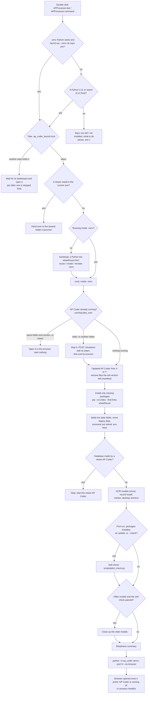

# How AP Coder runs

The end-to-end map of what happens from the double-click to the dashboard, on Windows, macOS and Linux: which
Python is used, what is installed and from where, what an update does to an older install, what is written where,
and every place the network could be touched. For IT (what to install, where to look) and for developers (where
each step lives: `file:function`). Everything here is read from the code; when the two disagree, the code wins and
this file is wrong.

AP Coder is an **offline** build: nothing it runs connects to the internet unless a developer or the bundle builder
sets `AP_ALLOW_INTERNET=1` (`ap_coder/ops/offline.py:internet_allowed`). The one exception, by design, is the optional
Azure check, which AP switches on in Settings (it is off by default; [section 10](#10-the-network-every-place-and-its-gate)).
The setup is offline too from the offline bundle; from the code alone (GitHub's ZIP or a git checkout: no
`bundle_manifest.json`, `wheelhouse/` or `models/`) it downloads its packages and OCR models once, unless
`AP_ALLOW_INTERNET=0` (`scripts/launch.py:plain_download`); the dashboard it starts stays offline.

Contents: [1 The files](#1-the-files-that-start-ap-coder) ·
[2 Flowchart](#2-the-launcher-at-a-glance) ·
[3 Finding Python](#3-finding-python) ·
[4 The .venv](#4-the-venv) ·
[5 Packages](#5-packages-the-wheelhouse-and-pip) ·
[6 Update and takeover](#6-update-and-takeover-from-an-older-install) ·
[7 Data, models, checks, shortcut](#7-data-folder-models-self-check-shortcut) ·
[8 The server](#8-the-server) ·
[9 Data folder and what is written where](#9-the-data-folder-and-everything-ap-coder-writes) ·
[10 Network](#10-the-network-every-place-and-its-gate) ·
[11 Per-OS notes and troubleshooting](#11-per-os-notes-and-troubleshooting) ·
[12 Compared with CloseDesk](#12-compared-with-closedesk) ·
[13 Bugs found in this pass](#13-bugs-and-inconsistencies-found-while-mapping)

## 1. The files that start AP Coder

| File | What it does |
| --- | --- |
| `APProcessor.bat` (Windows) | The double-click. Finds a Python, then runs `scripts\launch.py` with it. ASCII, CRLF, every path quoted (`tests/test_launcher_scripts.py`). |
| `APProcessor.command` (macOS; Linux from a terminal) | The same for bash 3.2 (macOS's `/bin/bash`). |
| `APProcessor.bat --installer` / `./APProcessor.command --installer` | The same setup plus the installer's questions (`scripts/install.py`; its options after `--installer`). Run over or beside an older version it does what the double-click does (stale files removed, old settings retired, older installs cleaned up after the self-check); run again with nothing changed it says *Nothing to update* in seconds. |
| `scripts\terminal.bat` (Windows) | A command prompt in AP Coder's folder (the one above `scripts\`) with `.venv\Scripts` first on `PATH` (no `activate.bat`, which hard-codes the folder the .venv was made in). |
| `scripts/launch.py` | Every step after Python is found (standard library only until the packages are installed). |
| `scripts/running.py` | Finds an AP Coder already running and stops an older one. |
| `scripts/upgrade.py` | Taking over from older installs: record, data move, file paths, stale files, clean-up. |
| `scripts/check_deps.py` | Which requirements in `pyproject.toml` are missing or too old. |
| `scripts/first_run.py` | `choose_data_dir` (used by the launcher); run alone it also copies the models. |
| `scripts/fetch_models.py` | Copies the PP-OCRv5 OCR models from the bundle's `models/` into place. |
| `scripts/pilot_check.py` | The self-check: reads the ten sample invoices with no AI model and no Azure. |
| `scripts/build_offline_bundle.py` | IT, on a computer with internet: builds the offline ZIP (code, `wheelhouse/`, `models/`, `bundle_manifest.json`). |
| `ap_coder/ops/cli.py:cmd_serve` → `ap_coder/web/server.py:serve` | The dashboard server (`python -m ap_coder serve`). |

One file to open per computer: older versions also shipped `install.bat` / `install.sh`, `start.bat` / `start.sh`
and a top-level `terminal.bat`. Unzipped over such a folder, the new version removes them (`scripts/upgrade.py:prune_stale`),
and `scripts/upgrade.py:LAUNCHERS` still recognises a folder that has only them.

## 2. The launcher at a glance

Two processes take part on a first run: the Python the double-click found runs *phase 1*
(`scripts/launch.py:bootstrap`: make `.venv`), then `.venv`'s Python runs *phase 2* (`scripts/launch.py:run`) with
`--venv=created|recreated|reused`. Phase 1 holds the lock for both (`AP_LAUNCH_LOCK_HELD` tells phase 2). Once
`.venv` works, the double-click starts phase 2 directly. Everything said by either phase also goes to
`~/.ap_coder/logs/launch.log` ([section 9](#9-the-data-folder-and-everything-ap-coder-writes)).

Options (`scripts/launch.py:parse`): `--check` (run the self-check again), `--no-start`, `--yes`, `--installer`;
anything else (`--port 8502`, `--address 0.0.0.0`) goes to the server. Environment: `AP_NO_PAUSE=1` (no "Press a
key" at the end, for automated runs), `AP_ALLOW_INTERNET=1` (developers), `BROWSER=none` (open no browser).

## 3. Finding Python

AP Coder runs on any CPython **3.11 or newer** (`scripts/launch.py:MINIMUM`; no upper bound). 3.12 is preferred,
then the other versions the offline bundle is built for (3.11, 3.13, 3.14), because the wheelhouse has packages
only for those. `pyproject.toml` says `>=3.11` too, and `ap_coder/ops/doctor.py` fails on an older one (D-55).
Python is never installed by the offline build.

### Windows: `APProcessor.bat`

1. `pushd "%~dp0"` (not `cd`: from a network share `\\server\share\AP Coder` it maps a drive letter first).
2. `PYTHON_MANAGER_AUTOMATIC_INSTALL=false`: asking the new Python install manager's `py` for a version that is not
   installed never downloads it.
3. **`.venv` first** (`:venvpython`): `.venv\Scripts\python.exe scripts\launch.py --venv-ok` must exit 0
   (`scripts/launch.py:venv_fits`: pip is there, and it is not the case that the bundle has no packages for this
   .venv's Python *and* AP Coder's core packages are missing *and* a Python the bundle fits is installed). Then that
   Python is used whatever version made it.
4. **`:findpython`**, first that is 3.11 or newer wins:
   `py -3.12`, `py -3.11`, `py -3.13`, `py -3.14`, `py -3`, `python`, `python3`, then
   `%LOCALAPPDATA%\Programs\Python\Python312|311|313|314\python.exe`, `%ProgramFiles%\Python312|...\python.exe`, then
   any `Python3*` folder in those two places.
5. **`:try`** asks each one `sys.exit(major*100 + minor)` with no window and no input (`<nul >nul 2>&1`): the exit
   code is the version (312). Anything below 200 or from 400 up is "not a Python": the py launcher's "no such
   version" code, and **the Microsoft Store alias** (`WindowsApps\python.exe` when Python is not installed), which,
   given arguments, prints a hint and exits 9009 instead of opening the Store. A Python older than 3.11 is
   remembered (`OLDPY`) so the message says *"Python 3.10 is installed, but AP Coder needs 3.11 or newer"*, not
   "not installed".
6. From the code alone (no `bundle_manifest.json`, `wheelhouse\` or `models\`), or with `AP_ALLOW_INTERNET=1`, and
   never with `AP_ALLOW_INTERNET=0`; `winget` present: `:installpython` offers `winget install Python.Python.3.12
   --scope user`, then searches again.
7. None: the message says to ask IT for Python 3.12 from python.org with *Add python.exe to PATH*; `:fail` pauses
   (unless `AP_NO_PAUSE`) and exits 1.

### macOS and Linux: `APProcessor.command`

1. `cd "$(dirname "$0")"`.
2. **`.venv` first**: `.venv/bin/python scripts/launch.py --venv-ok` (as on Windows).
3. **`candidates`**: `python3.12`, `python3.11`, `python3.13`, `python3.14`, `python3.15` … `python3.40`, `python3`,
   `python` on `PATH`; on a Mac also `/opt/homebrew/bin/…` (Homebrew, Apple silicon), `/usr/local/bin/…` (Homebrew
   on Intel, python.org's links) and `/Library/Frameworks/Python.framework/Versions/3.x/bin/` (python.org). A Finder
   double-click gets launchd's short `PATH` (`/usr/bin:/bin:…`), so these folders are listed explicitly.
4. **`find_python`**: each candidate is resolved (`command -v`), asked its version (`py_version`), deduplicated, and
   ranked (`rank`): 3.12, 3.11, 3.13, 3.14 in that order, then any newer 3.x; the best rank wins, the first found on
   a tie (so `python3` that is 3.12 beats `python3.14`). Older ones only feed the "too old" message.
5. **Apple's stand-in** `/usr/bin/python3` (without Xcode or the Command Line Tools it only opens an install
   dialog) is not even run unless `xcode-select -p` names a developer folder that has `usr/bin/python3`
   (`apple_python_ok`); asking `xcode-select` never opens a dialog.
6. None: says what to install (`brew install python@3.12` or python.org) and `stop`s (pause unless `AP_NO_PAUSE`).

The script is bash 3.2 (no associative arrays, `mapfile`, `${var,,}`, `&>>`…): `tests/test_launcher_scripts.py`
refuses every bash-4-only form and runs `bash -n` on it.

### Inside launch.py: a better Python than the one found

`scripts/launch.py:bootstrap` reads which Python versions the wheelhouse can serve on this computer
(`fitting_pythons`: from the compiled core wheels' tags, numpy, pandas, pyarrow, pymupdf, pillow, pydantic-core;
from `bundle_manifest.json`'s `targets` when there are none). If the Python found is not one of them and another
installed one is (`find_python`: `py -3.X` and the python.org folders on Windows; `python3.X` on `PATH`, Homebrew and
python.org on a Mac), it re-runs itself with that one (*"Python 3.14 has no packages in this offline bundle: using
Python 3.12"*).

## 4. The .venv

`scripts/launch.py:ensure_venv`:

* **reused** when `venv_works` (its Python starts and `import encodings, pip` works): nothing is reinstalled;
* **created** with `python -m venv .venv` the first time;
* **recreated** (deleted, then made again) when it is broken, or when `bootstrap` decides to *rebuild*: .venv was
  made with a Python the wheelhouse has no packages for, the Python running now is one it has, and `--venv-ok`
  says no. A .venv that can't be deleted stops with "close every AP Coder window, delete the .venv folder".
* Linux: Debian and Ubuntu's own Python can't make a .venv without the `python3.X-venv` package (no `ensurepip`);
  the hint then names it (`sudo apt install python3.12-venv`) instead of "reinstall Python".

What the .venv has been through is kept in `.venv/ap_coder_launcher.json` (`STATE`: `setup_done`, `fingerprint`,
`version`, `build`, `commit`, `port`, `self_check`, and the "tried once" marks `ocr_failed`, `ocr2_failed`,
`azure_failed`, `models_failed` (with `models_tries`: a failed download's starts today); it goes with the .venv when
that is remade. The fingerprint is `pyproject.toml` plus the build (`ap_coder/core/paths.py:build_stamp`: the
commit in `ap_coder/BUILD`, which GitHub's ZIP and the offline bundle fill in; a checkout's HEAD; else a hash of the
code), so a newer build of the same version is an update too.

## 5. Packages: the wheelhouse and pip

`scripts/launch.py:ensure_packages` → `_ensure_packages`, on every start:

1. **What is missing** (`missing_packages` → `scripts/check_deps.py:problem`, `self_problem`): each requirement of
   `pyproject.toml` (and the `ocr` extra) that is not installed or is older than asked, and whether `ap_coder`
   itself is installed (editable) *from this folder* (read from pip's `direct_url.json`, network shares included).
   Nothing missing: "Packages: all N in place", nothing runs.
2. **Where from** (`pip_source`): the offline bundle's `wheelhouse/` with `--no-index --find-links` (never the
   internet). Without one: PyPI from the code alone (`setup_online`, unless `AP_ALLOW_INTERNET=0`) or with
   `AP_ALLOW_INTERNET=1`; else (a bundle missing its wheelhouse) nowhere (`without_wheelhouse`: AP Coder still
   starts when its core packages are there, and says what is missing; core missing stops with "unzip the full
   offline bundle").
3. **The wheelhouse folder** (`wheelhouse_dir`): `wheelhouse/`, or the one folder of wheels inside it (a wheelhouse
   copied over another lands in `wheelhouse/wheelhouse`), else one **near-miss** name (`NEAR_MISS`: `.wheelhouse`,
   `wheelhouse (1)`, `Wheelhouse-old`, or `<bundle>/wheelhouse` of a bundle unzipped into this folder). Several
   near-misses: nothing is guessed; the start stops and names them.
4. **Does it fit** (`wheelhouse_misfit`): the core wheels' tags are compared with this Python's (`here_tags`, as pip
   judges them). A Windows wheelhouse on a Mac, or cp312 wheels for Python 3.14, stops with one plain sentence
   (which bundle or Python to use) instead of pip's long error. With `AP_ALLOW_INTERNET=1` it falls back to PyPI.
5. **pip** (`pip_install`): `python -m pip install --disable-pip-version-check --progress-bar off <source> …`, its
   "already satisfied" lines hidden. First install: `-e .[ocr]`, then `-e .` if the OCR add-on fails (AP Coder runs
   without OCR; not tried again until `pyproject.toml` changes: `ocr_failed`). Later: only the missing
   requirements. A full disk (`DISK_FULL`) is said as that, with the size of the older installs' .venv folders.
6. **Python 3.13+** (`ensure_second_ocr`): `rapidocr-onnxruntime` says "below 3.13" in its metadata but is pure
   Python: installed with `--ignore-requires-python` from the wheelhouse, once per version.
7. **The optional Azure check's packages** (`ensure_azure`): from the wheelhouse only, when it carries them; never
   from the internet, never a reason to stop.
8. **Registration** (`refresh_registration`): unzipped over an older version, `ap_coder` is registered again
   (`--no-deps -e .`) so the running server reports the new version.

## 6. Update and takeover from an older install

A new version is installed by unzipping its bundle **anywhere** (a new folder, or over the old one) and
double-clicking its `APProcessor`. Nothing is installed twice; the data is never opened by older code.

**The record** (`ap_coder/core/paths.py`): `~/.ap_coder/settings.json` (`AP_USER_SETTINGS` overrides) holds `data_dir`,
`installs` (each folder started: version, build, last run), `current`, `desktop_shortcut`, `shortcut_target`,
`data_move` (while a move runs) and the reviewer's name. Written whole to a `.part` file, then replaced
(`write_user_settings`).

**Before anything** (`scripts/launch.py:_main`, phase 1): `scripts/upgrade.py:newer_install` — when the current
install is another folder holding a newer version (read from that folder's `pyproject.toml` and
`bundle_manifest.json`, not only the record), this older folder hands over to it (`hand_over`) and puts itself on
record so the newest cleans it up.

**Already running** (`scripts/running.py:take_over`, at the start of `run`): candidate ports are the one asked for,
this folder's last, every install's last, 8501, and the one in `<data>/.ap_coder_server.json`. On each:

* **0.2+ server**: `GET http://127.0.0.1:<port>/healthz` (no proxy) answers `{"app": "ap-coder", version, folder,
  pid, port, user}` (`user`, the computer account running it, only to this computer). Another account's (a second
  Windows user sharing the folder): never opened (it works under that person's name) nor stopped; the start says
  whose it is and stops (`scripts/launch.py:someone_elses`). Same folder and version: opened, nothing started.
  Newer: opened, never stopped. Older, or another folder: `POST /shutdown` with `X-AP-Coder-Token` from the server file; if that fails, the process listening on
  the port (`port_owner`: `/proc` on Linux, `lsof` on a Mac, `Get-NetTCPConnection` on Windows) is ended, but only
  when its command line is AP Coder's (`is_ap_coder_process`).
* **0.1 Streamlit dashboard** (no `/healthz`): recognised by its font `/app/static/InterVariable.woff2`, stopped
  through its process (`streamlit run …ap_coder…dashboard.py`); its folder (from the command line) is remembered for
  the clean-up.
* **`watch` / `read-pages`** (`scripts/running.py:workers`): each leaves `<data>/.ap_coder_worker-<pid>.json` (pid,
  command, folder, version) while it runs (`ap_coder/ops/cli.py:running_note`). An older one, or one from another
  folder, is stopped (`stop_worker`: as Ctrl+C, then ended; only a process whose command line is AP Coder's
  `watch` / `read-pages`) before the clean-up deletes the `.venv` it runs from: it would otherwise mark every new
  invoice failed. A note whose process is gone is removed.
* Can't be stopped: "close the old AP Coder window", waiting up to a minute, then the start stops (`blocked`).

**"Updated AP Coder from X to Y"** (`previous_install`): this folder's `.venv` state names another fingerprint,
version or build; or, in a new folder, the newest older install on record.

**Stale files** (`scripts/upgrade.py:prune_stale`): only when `bundle_manifest.json` lists the bundle's files and the
folder is not a git checkout. Files under `ap_coder/`, `scripts/`, `tests/`, `samples/`, `wheelhouse/`, `models/`
that the manifest does not list are deleted (a folder only when this bundle's own files for it are there), and AP
Coder's own top-level files it no longer ships (e.g. `streamlit_app.py`). Never `private/`, `data/`, `docs/`.

**The data folder** (`scripts/upgrade.py:settle_data_folder`, through `scripts/first_run.py:choose_data_dir`):
`AP_PRIVATE_DIR` as it is; else a move on record (`data_move`) is finished first; else the recorded folder; else
`~/APCoder` (or this folder's `private/` when it already holds data) is recorded. Data kept inside a code folder
(`<folder>/private`, AP Coder 0.1) is moved to `~/APCoder` (`move_data`: recorded while it runs, resumed by the next
start, a failure stops the start: AP Coder never runs on half the data), unless `~/APCoder` already holds other
data (then it stays, and that is said).

**The settings file** (`scripts/launch.py:settle_settings`): a `.env` or data left in the code folder moves to the
data folder (`upgrade.adopt_legacy`; when the data folder has its own, the old one goes whole to
`backups/from-<folder>-<date>/`); settings no longer read (`ap_coder/core/config.py:RETIRED_SETTINGS`: `AP_PAGE_READER`,
`AP_PAGE_READER_SCOPE`, `AP_LLM_PROVIDER`) are commented out with a note (`ap_coder/core/envfile.py:retire`).

**File paths** (`scripts/upgrade.py:repoint_files`): invoices record their file as an absolute path. Every path into
an older folder (its `private/` invoices, its `samples/` demo invoices) is pointed at the file's new place, or the
file is copied into `data/invoices/`, in one transaction after a backup (`_backed_up`:
`backups/ap_coder-<date>-before-update-file-paths.db`). While the database still needs a file it could not copy,
the older folder is kept.

**The database** (`ap_coder/core/store/_base.py:StoreCore._before_migrating`, `_migrate`): `settings.schema_version`
(now `SCHEMA_VERSION = 16`). Older: backed up first (`backups/ap_coder-<date>-before-update-from-schema-<n>.db`), then
migrated step by step. Newer: refused (`DatabaseTooNew`) and never opened. The launcher checks this before starting
the server (`scripts/launch.py:database_too_new`) and stops with "start the newer AP Coder".

**Clean-up** (`scripts/upgrade.py:clean_up`), only after the self-check passed: for each older install its data
moves out, its files are repointed, then the whole folder goes when `removable` allows (a bundle folder with
`APProcessor` and a manifest or `.ap_coder_install.json` marker, not a git checkout, not running — its launch lock
free —, holding nothing AP Coder did not put there: `user_files`). It is renamed first (`remove_folder`; fails at
once on Windows while a window still uses it) to `<name>.removing-<date>`, then deleted; what could not be deleted
is finished on a later start. A folder that must stay still loses its `.venv` and `models/`. The space freed is said.
A folder beside this one that was cleaned up that way and kept (nothing left to take: no `.venv`, `models/`, `.env`
or data) is not found again on later starts (`upgrade.left_to_clean`), so it is said once.

## 7. Data folder, models, self-check, shortcut

* **Data folder** (`scripts/launch.py:ensure_data_folder`): created with `invoices/`; the readiness line checks it is
  writable (`readiness`).
* **Database too new**: see above.
* **OCR models** (`scripts/launch.py:ensure_models` → `scripts/fetch_models.py:setup`): RapidOCR 3's PP-OCRv5 models
  (det, cls, rec) are copied from the bundle's `models/` into RapidOCR's package folder inside `.venv`, only when
  missing (SHA-256 checked on the first run, `ap_coder/ops/offline.py:missing_models`). Never downloaded offline; a
  failure is said once and not retried until the bundle's `models/` folder changes (`models_attempt`). From the code
  alone each download is tried 3 times; a failure is said in plain words (the error in the log) and tried again at
  the next start, up to 3 starts a day (`models_due`). Without them,
  scans are read by the second engine (`rapidocr-onnxruntime`, PP-OCRv4 models inside its package).
* **Table finder** (`ap_coder/ops/offline.py:table_finder_path`): RapidLayout's `yolov8n_layout_general6.onnx` is read in
  place from the bundle's `models/`, else `<data>/models/`, else `AP_TABLE_FINDER_MODEL`; SHA-256 checked; never
  copied or downloaded. Without it, line items are read as before.
* **Record and marker**: `paths.record_install` (this folder is current), `upgrade.write_marker`
  (`.ap_coder_install.json` in the code folder, not in a git checkout).
* **Desktop shortcut** (`scripts/launch.py:ensure_shortcut`): Windows, `AP Coder.lnk` to `APProcessor.bat` (written
  by PowerShell's `WScript.Shell`); Mac, `~/Desktop/AP Coder.command`, a two-line script that `exec`s the current
  install's `APProcessor.command` (only ever written over one of its own: `LAUNCHER_MARK`). Rewritten when the
  current install changes; one deleted or declined (`--installer --no-shortcut`) is not put back. Linux: none.
* **Self-check** (`scripts/launch.py:self_check` → `scripts/pilot_check.py`): on the first run, after packages were
  installed, after an update, with `--check`, or when older installs wait to be cleaned up and no self-check has run here yet. Reads the ten samples
  (no AI model, no Azure) and one as a scan with local OCR. A failure is said; AP Coder still starts; older installs
  are then kept.
* **Readiness summary** (`readiness`): Python, packages, OCR, data folder, LM Studio (`lm_studio_line`: asked for 1
  second, never started or installed), the page reader OvisOCR2 (`page_reader_line`), notes, shortcut, self-check.

## 8. The server

`scripts/launch.py:start_dashboard` starts `python -m ap_coder serve --port N --no-browser [options]` as a child:

* **Port**: `--port` when given, else the first from **8501** this computer can bind (`ap_coder/ops/offline.py:free_port`,
  which `python -m ap_coder serve` uses too: a bind test on the dashboard address, 50 tries, then one the system
  picks; on Windows without `SO_REUSEADDR`, which would let it take a port in use). The port is recorded in
  `.venv/ap_coder_launcher.json` so the next double-click finds it. `serve` on a port something already answers on
  says so and starts nothing (it never writes over a running server's file).
* **Address** (`ap_coder/ops/offline.py:dashboard_address`): `127.0.0.1`, unless `AP_DASHBOARD_ADDRESS` (or
  `--address`) says otherwise; listening beyond this computer prints a warning (there is no login).
* **Server** (`ap_coder/web/server.py:serve`): uvicorn in that process; a random token; the server file
  `<data>/.ap_coder_server.json` (`pid`, `port`, `folder`, `version`, `token`, `user`, `started`; mode 0600 on macOS/Linux),
  removed when it stops if it is still its own.
* **App** (`ap_coder/web/app.py:create_app`): `LocalOnly` middleware (`ap_coder/web/security.py`: a Host header
  that is not this computer is refused, against DNS rebinding; a POST must carry `X-AP-Coder: 1` and come from the
  same origin). `GET /healthz` (no secrets), `POST /shutdown` (loopback client and the token). At start-up
  (`lifespan`): `Store.auto_backup` (once a day), the page reader's background thread, the Azure check's thread (does
  nothing while it is off).
* **Up?** The server checks its own `/healthz` directly, never through a proxy, and prints `AP Coder is running at
  http://127.0.0.1:N`. The launcher opens `http://localhost:N` when it sees that line or `/healthz` answers
  (`running.health`), once.
* **Browser** (`scripts/launch.py:open_browser`, `ap_coder/ops/offline.py:browser_wanted`): not with `BROWSER=none`, and
  not on a Linux computer with neither `DISPLAY` nor `WAYLAND_DISPLAY` (over SSH: Python would start a text browser
  in this window); then the address is said.
* **Stop**: close the window or press Ctrl+C (the launcher ends the child, killing it after 15 s); the launcher of a
  newer version uses `POST /shutdown`.
* **One at a time** (`take_lock`): `.ap_coder_launch.lock` in the code folder, an OS lock (`msvcrt.locking` on
  Windows, `flock` elsewhere), held by the start for as long as its dashboard runs and released by the OS if it
  crashes. A second double-click opens the running dashboard (`running_dashboard`), waits for one being set up (up
  to 30 minutes, `wait_for_other`), or stops an older one (`stop_older`). `--installer` refuses while AP Coder runs.

## 9. The data folder and everything AP Coder writes

Default data folder `~/APCoder` (`C:\Users\<you>\APCoder`); `AP_PRIVATE_DIR` overrides it, the record
(`data_dir`) chooses it otherwise (`ap_coder/core/paths.py:private_dir`). Keep it out of OneDrive (`doctor` warns: sync
can corrupt an open SQLite database).

| Where | What | Written by |
| --- | --- | --- |
| **Code folder** `.venv/` | AP Coder's own Python and packages; the PP-OCRv5 models inside RapidOCR's package | `launch.ensure_venv`, pip, `fetch_models` |
| `.venv/ap_coder_launcher.json` | the launcher's state (above) | `launch.save_state` |
| `.ap_coder_launch.lock` | the one-start-at-a-time lock (empty) | `launch.take_lock` |
| `.ap_coder_install.json` | marker: a folder the launcher set up (version, build), so a later version may remove it | `upgrade.write_marker` |
| `ap_coder.egg-info/`, `__pycache__/` | pip's editable install, Python's caches | pip, Python |
| (deleted) | files an older version left (`prune_stale`); `private/` and `.env` (moved to the data folder) | `upgrade` |
| **Data folder** `ap_coder.db` (`-wal`, `-shm`) | the database (`AP_DB_PATH` overrides) | `Store` |
| `invoices/`, `invoices/deleted/`, `invoices/from-<folder>/` | invoice files; deleted ones; files copied out of an older folder | dashboard, `upgrade.repoint_files` |
| `backups/ap_coder-YYYYMMDD-HHMMSS.db` | daily backup when the dashboard starts, newest 14 kept; `-manual`; `-before-update-from-schema-<n>`; `-before-update-file-paths` | `Store.auto_backup`, `backup_now`, `_before_migrating`, `upgrade._backed_up` |
| `backups/from-<folder>-<date>/` | an older install's data when the data folder had its own | `upgrade.adopt_legacy` |
| `.env` | settings (Azure for developers, LM Studio address, reviewer…) | installer, Settings page, `adopt_legacy`, `envfile.retire` |
| `.ap_coder_server.json` | the running server: pid, port, folder, version, token, user (the computer account) | `web/server.write_server_file` |
| `.ap_coder_worker-<pid>.json` | a running `watch` or `read-pages`: pid, command, folder, version | `ops/cli.running_note` |
| `.cache/extraction/`, `.cache/page_reader/` | text read from each file, OvisOCR2's readings (by SHA-256) | capture, `page_reader` |
| `.cache/ocr/` | each scanned page's OCR, per engine (by the page image's SHA-256): a page is OCR'd once however often its invoice is read; at most 4,000, the oldest removed first | `capture/layout.ocr_cache` (the pipeline) |
| `output/`, `share_report.md`, `share_report_key.csv`, `labels.xlsx` | command-line outputs | `ap_coder/ops/cli.py` |
| `backup-<date>/` | the data set aside by `install --fresh-start` | `install.fresh_start` |
| `models/` (optional) | the table finder model, if IT puts it there | IT |
| **`~/.ap_coder/settings.json`** | the record of installs and the data folder (section 6) | `paths.write_user_settings` |
| **`~/.ap_coder/logs/launch.log`** | everything each start said, pip's lines and the dashboard's output; `launch.previous.log` past 1 MB | `launch.log` |
| **Desktop** `AP Coder.lnk` / `AP Coder.command` | the shortcut (Windows / Mac) | `launch.ensure_shortcut` |
| **Second backup folder** (Settings → Data & backups) | copies of the daily backups, newest 14 | `Store.copy_backup` |
| Next to an older install | `<folder>.removing-<date>` while it is deleted | `upgrade.remove_folder` |

**Backups**: one a day when the dashboard starts (`Store.auto_backup`, 20 hours apart, 14 kept), each a single
self-contained SQLite file (`journal_mode=DELETE`); one before every schema migration and before an update repoints
file paths; manual ones from Settings; optionally copied to a second folder. Restore from Settings → Data & backups.

**Logs**: `~/.ap_coder/logs/launch.log` holds every start (a header line with the time, options, Python and folder;
then what the window showed, pip's lines and the dashboard's own output and warnings). A step that fails names it;
an unexpected error is one line in the window and its traceback in the log. It holds file paths and the dashboard's
messages, so it stays on the computer like the data. The dashboard's Activity page is the audit trail.

## 10. The network: every place and its gate

| # | Where (file:function) | What it contacts | Gate |
| --- | --- | --- | --- |
| 1 | `scripts/launch.py:pip_install` / `pip_source` | pip: the `wheelhouse/` folder (`--no-index`) | PyPI from the code alone (no bundle: `scripts/launch.py:setup_online`) or with `AP_ALLOW_INTERNET=1`; never with `AP_ALLOW_INTERNET=0`; the Azure extra never from PyPI |
| 2 | `APProcessor.bat:installpython` | winget (Python 3.12 from the internet) | from the code alone or with `AP_ALLOW_INTERNET=1`, never with `AP_ALLOW_INTERNET=0`; when no Python is found, and asked |
| 3 | `scripts/fetch_models.py:download` | www.modelscope.cn (OCR, table finder models) | raises without `AP_ALLOW_INTERNET=1`; the launcher sets it for this step only from the code alone (`scripts/launch.py:ensure_models`, `setup_downloads`), never with `AP_ALLOW_INTERNET=0` |
| 4 | `scripts/install.py:update_code` | `git fetch` / `git pull` of a checkout | only with `AP_ALLOW_INTERNET=1` |
| 5 | `scripts/build_offline_bundle.py` | PyPI, modelscope | IT's online computer; sets the opt-in for itself |
| 6 | `scripts/running.py:health`, `ask_to_stop`, `legacy_dashboard` | `127.0.0.1:<port>` only | never through a proxy (`ProxyHandler({})`) |
| 7 | `ap_coder/web/server.py:_announce_when_up` | its own `/healthz` | direct, never through a proxy |
| 8 | `ap_coder/ai/local_llm.py:check_server`, `build_local_client`; `ap_coder/ai/page_reader.py:_post_json`, `_client` | LM Studio / Ollama at `AP_LLM_BASE_URL` / `AP_PAGE_READER_BASE_URL` (default `127.0.0.1:1234`) | this computer or the office network (private address, bare or `.local`/`.lan` name) only; an internet address only with `AP_ALLOW_INTERNET=1` (`refused_address`); no proxy for a local one |
| 9 | `ap_coder/ai/extraction.py:DocumentExtractor` | Azure Document Intelligence as the reader | only with `AP_ALLOW_INTERNET=1` and an endpoint |
| 10 | `ap_coder/ai/inference.py:build_openai_client` | Azure OpenAI for coding | `local_llm.resolve_provider`: only with `AP_ALLOW_INTERNET=1` and an endpoint |
| 11 | `ap_coder/ops/doctor.py` (`--online`) | Azure | only with `AP_ALLOW_INTERNET=1` |
| 12 | `ap_coder/ai/azure_check.py` | the one Azure Document Intelligence endpoint in the `.env` (`only_host` checks every request, redirects included) | **its own switch** in Settings → Reading (off by default), with its packages, endpoint and key; not `AP_ALLOW_INTERNET` (by design) |
| 13 | `ap_coder/web/security.py:host_allowed` | `socket.getfqdn()` (a DNS lookup of this computer's name) | only when listening on every network (`AP_DASHBOARD_ADDRESS=0.0.0.0`) and a request names a host |
| 14 | the dashboard itself | listens on `127.0.0.1:8501` | `AP_DASHBOARD_ADDRESS` opens it to the office network (inbound; a warning is printed) |
| 15 | RapidOCR's own model downloader | (would fetch models on first use) | never runs: the engine is given the model paths (`offline.ppocrv5_engine_params`) and used only when they are intact (`ppocrv5_ready`) |
| 16 | fonts, icons, scripts of the pages | — | served from the package (`/fonts`, `/static`); no CDN |
| 17 | `Store.copy_backup` | the second backup folder (may be a network share) | only when AP sets one in Settings |

Tests: `tests/test_offline*.py`, `tests/test_network_gates.py`, and a web test that fails if a page connects out.

## 11. Per-OS notes and troubleshooting

**Windows.** Any folder name works (spaces, `( )`, `&`, accents): every path in the .bat files is quoted, and they
are ASCII with CRLF (`.gitattributes: *.bat -text` keeps them so in a ZIP). A UNC share works through `pushd`.
`scripts\terminal.bat` gives a prompt where `python` is .venv's. Closing the window ends AP Coder (the server file may stay;
the next start ignores a server file whose port does not answer). PowerShell is used for the desktop folder, the
shortcut and finding an old dashboard's process; where it is blocked, the shortcut is "tried again next time" and an
old dashboard must be closed by hand.

**macOS.** The first time: right-click → *Open* (Gatekeeper; the bundle ZIP keeps the executable bit:
`build_offline_bundle` writes mode 755 for `.command`). Python from python.org or Homebrew; Apple's
`/usr/bin/python3` only with the developer tools. The desktop launcher is a `.command` script, not an alias.

**Linux.** Run `./APProcessor.command` from a terminal; file managers do not run `.command`
files. No desktop shortcut. Debian/Ubuntu need `python3.X-venv`. Without a desktop (SSH), no browser is opened: the
address is printed; forward the port (`ssh -L 8501:127.0.0.1:8501`) to use it from another computer.

| What you see | What it means / what to do |
| --- | --- |
| *Python 3.10 is installed, but AP Coder needs Python 3.11 or newer* | IT installs Python 3.12 next to it; double-click again. |
| *This package folder (wheelhouse) was built for …* | The bundle is for another OS or Python: use the right bundle, or install the Python it names. |
| *There are several package folders here, none named wheelhouse* | Keep the newest bundle's, rename it `wheelhouse`, delete the others. |
| *Installing the packages stopped: the disk is full* | Free about 1.5 GB (an older install's `.venv` can go). |
| *Could not create the .venv folder* (Linux) | `sudo apt install python3.X-venv`. |
| *Your database … was made by a newer AP Coder* | An older folder was started: use the newest (its folder is named). |
| *An older AP Coder is still running (port N)* | Close the old window; start again. |
| *AP Coder stopped on an unexpected error* | Start again; if it repeats, send `~/.ap_coder/logs/launch.log`. |
| The browser did not open | Open the address the window shows (`http://localhost:8501`); `BROWSER=none` or no desktop skips it. |

## 12. Compared with CloseDesk

CloseDesk (`/home/user/mnabikhel/outlook-email`, the sibling app) starts with two short scripts, `CloseDesk.bat`
(52 lines) and `CloseDesk.command` (37 lines), which make `.venv`, `pip install -e ".[ocr]"` online, check
`scripts/check_deps.py`, and run `python -m controller_inbox run` (read the drop folder, write the digest, then
uvicorn on port 8765 in the same process).

| Step | CloseDesk | AP Coder | Verdict |
| --- | --- | --- | --- |
| Launcher logic | in the .bat / .command | thin .bat / .command, steps in `scripts/launch.py` | **Keep**: one tested implementation for three OSes |
| Python on Windows | `where py` → `py -3`, else `python`; version not checked | version-checked list, 3.12 first, Store alias and py install manager safe, "too old" said | **Keep** |
| Python on Mac/Linux | `python3 \|\| python` | ranked versions, Homebrew and python.org folders, Apple stub never run | **Keep** |
| Folder | `cd /d "%~dp0"` | `pushd "%~dp0"` (network shares) | **Keep** |
| .venv | made once if missing, never repaired | reused; remade when broken or for a Python the bundle lacks | **Keep** |
| Packages | online pip (also upgrades pip) | offline wheelhouse `--no-index`; fit checked first; only what is missing | **Keep** (offline is the requirement) |
| Update check each start | `scripts/check_deps.py` | the same idea, extended (extras, editable from this folder, registration) | **Same** |
| Optional add-ons | Camelot install tried on every start | OCR / Azure tried once per version | **Keep** |
| Data | `./data`, `./inbox`, `.env` in the code folder | one data folder outside the code, recorded | **Keep** |
| Updating | download the ZIP again, copy `data` and `inbox` by hand | unzip anywhere; takeover, data move, cleanup | **Keep** |
| Second double-click | uvicorn fails: port in use | lock; the running dashboard is opened | **Keep** |
| Older version running | — | stopped through `/shutdown` + token, or its process | **Keep** |
| Port | fixed 8765 (env setting) | 8501 or the next free one, recorded | **Keep** |
| Browser | opened after a fixed 1.5 s timer (may be before the server is up) | opened when the server says it is up | **Keep** |
| Host / origin guard, non-loopback warning | `LocalHostOnly`, warning | `LocalOnly` (modelled on it), warning | **Same** |
| Line endings | `.gitattributes: *.bat text eol=crlf` | `*.bat -text` (stored CRLF) | **Keep**, now with a test |
| Run log | a log per run (`data/overnight/<date>.md`, `scheduler.log`) | console only | **Adopted**: `~/.ap_coder/logs/launch.log` |
| Errors | "The message above says why", pause | one line + "What to do" + pause; a raw traceback for an unexpected error | **Adopted** the log: one plain line, traceback in the log |
| Unattended run | `scripts/overnight.bat` / `.sh` for Task Scheduler / cron | `python -m ap_coder watch` started by hand | **Recommend** (below) |
| Model server address | any URL, hosted gateways included | this computer or office network; internet only with the opt-in | **Keep** (offline build; enforced in this pass) |
| Desktop shortcut | none | Windows `.lnk`, Mac `.command` | **Keep** |
| Self-check, backups | none | `pilot_check.py`; daily DB backups | **Keep** |
| CI | pytest on three OSes | pytest, plus real launcher runs (offline bundle, update over 0.1) | **Keep** |

**Adopted in this pass** (each with a test that failed first): the launcher's log file and the plain report of an
unexpected error (`tests/test_launch_log.py`).

**Recommended, not done** (bigger than a small safe change):

* A scheduled, unattended reading run like CloseDesk's `overnight.bat`/`.sh` (a wrapper for Task Scheduler / cron
  around `watch --once`, logging to the data folder). It needs a lock shared with the dashboard's own reading so two
  never process the same invoice.
* A Linux `.desktop` launcher, and finding Python from pyenv / conda locations on macOS.
* `scripts/running.py` checks `127.0.0.1` only: a dashboard bound to one specific LAN address
  (`AP_DASHBOARD_ADDRESS=192.168.1.20`) is not found by a second double-click, which then waits for it. Use
  `0.0.0.0` to open it to the network.
* The page reader's cache follows `private_dir()` while the dashboard's follows the database's folder: with
  `AP_DB_PATH` elsewhere they split. One rule for both.

## 13. Bugs and inconsistencies found while mapping

Fixed, each with a test that failed first:

| Bug | Fix | Test |
| --- | --- | --- |
| `APProcessor.bat` echoed its own folder unquoted when `pushd` failed: in a folder named `R&D` cmd ran the rest as a command | quoted | `tests/test_launcher_scripts.py` |
| The server's own "is it up?" request went through the office proxy (`HTTP_PROXY`, Windows' setting): behind one, `python -m ap_coder serve` never printed its address nor opened the browser | direct opener | `tests/test_network_gates.py` |
| `AP_LLM_BASE_URL` / `AP_PAGE_READER_BASE_URL` naming an internet host was contacted without `AP_ALLOW_INTERNET` (invoice text could leave the computer) | `local_llm.refused_address` gates all three ways out | `tests/test_network_gates.py` |
| Linux without a desktop: `webbrowser` ran a text browser inside the AP Coder window and the launcher waited in it | `offline.browser_wanted` | `tests/test_browser_open.py` |
| Debian/Ubuntu Python without `python3.X-venv`: the hint said to reinstall Python from python.org | names the package | `tests/test_launch.py` |
| An unexpected exception printed a raw traceback under "The message above says what to do" | one plain line, traceback in the log | `tests/test_launch_log.py` |
| `terminal.bat` had no `setlocal`: run from an open prompt, it left `.venv` on that prompt's `PATH` (twice when run twice) | `setlocal` | `tests/test_launcher_scripts.py` |

Checked and found right: `APProcessor.command` uses only bash 3.2 forms; every .bat path is quoted otherwise, the
.bat files are ASCII and CRLF and never `cd` without `/d`; the Store alias and the py install manager never install
anything; the bundle keeps the launchers executable.

Documentation that did not match the code (corrected): `README.md` said the dashboard only ever listens on
`127.0.0.1` (`AP_DASHBOARD_ADDRESS` can open it) and that `AP_LLM_BASE_URL` takes any address;
`scripts/build_offline_bundle.py` said stale files are pruned under five folders (also `samples/`, and retired
top-level files) and that `models/` holds the OCR models only (also the table finder).
